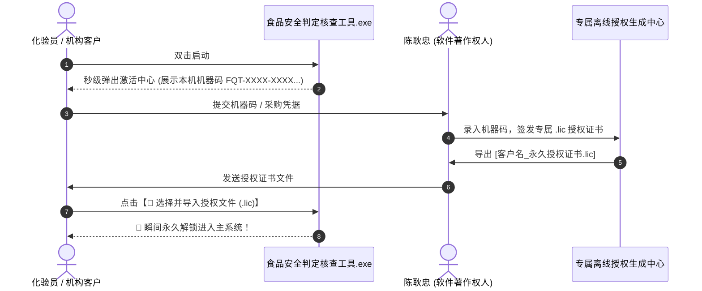

# 🛡️ 食品安全国家标准判定核查与实验室质控数字化工作台
### Food Safety Standards Compliance & Lab Quality Control Suite

  
  
  
  

---

## 📖 项目简介 (Overview)

**《食品安全国家标准判定核查与实验室质控数字化工作台》** 是一款面向 **第三方食品检验检测机构、海关农残理化实验室、食品生产企业 QA/QC 部门及认证审核员** 打造的专业级桌面数字化生产力工具。

本系统由 **国家注册审核员（ISO 22000 / HACCP）、实验室理化质控专家 陈耿忠** 结合多年一线实验室文控、方法验证（GB/T 27404-2026）、CNAS/CMA 资质评审及标准查新实战经验倾力研发。

> **💡 核心设计理念**：
> 1. **全景数据内置**：收录 6 大核心国家标准现行有效限量共计 **83,973 条**，纯离线秒级检索；
> 2. **台账智能反写 (Excel自动匹配)**：支持直接导入原始台账/委托单，自动跨 6 大国标匹配并反写判定标准、限量要求、检验方法、检出限(LOD)与实测结论；
> 3. **精准匹配绝对置顶**：搜索样品名称或检测项目时，完全吻合条目严格排在首位，杜绝长词混杂干扰；
> 4. **全线集成检验方法与智能气泡**：全面覆盖 GB 5009、GB 23200、GB 4789、GB 31658 及 2026 年国家食品安全抽检细则推荐方法，支持气泡悬停完整展示与划词复制。

---

## 🏛️ 权威国家标准数据库覆盖 (83,973 条现行限量)

系统深度整合了食品检测领域全部主流通用安全标准（全量内置入独立程序，无须联网）：

| 序号 | 国家标准代号 | 权威标准全称 | 限量数据条数 | 涵盖核心检测维度 |
| :---: | :--- | :--- | :---: | :--- |
| 1 | **GB 2760-2024** | 《食品安全国家标准 食品添加剂使用标准》 | **32,937 条** | 2024新版：脱氢乙酸全面禁用、甜味剂与防腐剂使用限量 |
| 2 | **GB 2763-2026** | 《食品安全国家标准 食品中农药最大残留限量》 | **48,878 条** | 蔬菜、水果、粮食、茶叶、坚果全品类农药 MRL 限量 |
| 3 | **GB 31650-2019** | 《食品安全国家标准 食品中兽药最大残留限量》 | **1,531 条** | 畜禽肉、水产品、鲜蛋、生乳之抗生素、瘦肉精、违禁兽药 |
| 4 | **GB 2762-2025** | 《食品安全国家标准 食品中污染物限量》 | **293 条** | 铅、镉、总汞、砷、铬、苯并[a]芘、亚硝酸盐限量 |
| 5 | **GB 29921-2021** | 《食品安全国家标准 预包装食品中致病菌限量》 | **239 条** | 沙门氏菌、单增李斯特菌、金葡菌等三级采样方案 ($n,c,m,M$) |
| 6 | **GB 2761-2017** | 《食品安全国家标准 食品中真菌毒素限量》 | **95 条** | 黄曲霉毒素B1/M1、脱氧雪腐镰刀菌烯醇(DON)、展青霉素 |

---

## 🚀 十大核心功能矩阵 (Key Features)

### 1️⃣ 台账智能反写 (Excel自动匹配) —— V1.2 重磅新增
* **一键导入台账**：支持各类外部 Excel 工作簿（`.xlsx`、`.xls`）及 CSV 委托单直接导入；
* **智能字段推导**：系统自动识别并映射“样品名称列”、“检测项目列”与“检验实测值列(可选)”；
* **毫秒级跨标全量反写**：跨 6 大国标（83,973 条数据）秒级完成匹配，自动回写：
  - **【反写】判定标准代号与标准全称**
  - **【反写】标准限量要求**
  - **【反写】推荐检验方法**
  - **【反写】权威方法检出限 (LOD)**
  - **【反写】实测判定结论**（若有实测值，自动计算合格/不合格）
  - **【反写】匹配状态**（精准匹配 / 品类推导匹配 / 禁用判定）
* **内置标准模板生成**：提供《标准台账导入模板.xlsx》一键下载，内含 10 种典型样品/指标示例；
* **高保真 Excel 导出**：自动生成午夜蓝（`#0F172A`）商务级表格，合格（翡翠绿）与超标（朱红）智能高亮，列宽自适应不截断。

### 2️⃣ 搜索精准匹配优先置顶 —— V1.2 核心优化
* **精准吻合严格置顶**：搜索“样品名称”或“检测项目/参数”时，完全精准匹配的数据项置顶排序（Rank 0）；
* **层级智能排频**：完全精准吻合 > 品类完全吻合 > 括号子项/常用分词吻合 > 前缀吻合 > 包含吻合 > 检验方法/备注命中；
* **长词干扰彻底清零**：搜索“阿维菌素”优先显示“阿维菌素”，避免“甲氨基阿维菌素苯甲酸盐”混杂；搜索“大米”优先展示纯大米分类，大幅提高查询效率。

### 3️⃣ 权威检验方法智能匹配与全流程指引
* **全表贯通检验方法**：在多项目批量判定、标准查询与样品匹配所有核心表格中增设独立 **【检验方法】** 列；
* **权威多层匹配引擎**：融合 GB 2762、GB 2763、GB 29921 自带方法与《2026年国家食品安全抽检实施细则》官方推荐方法，覆盖 GB 5009.xx、GB 23200.xx、GB 4789.xx、GB 31658.xx 等上百个细分检测方法；
* **详情卡片与一键复制**：双击详情卡片支持一键复制检验方法标准号，左侧判定面板设专属“📋 一键复制”按钮。

### 4️⃣ 单元格高级智能气泡悬浮与划词复制
* **防截断悬浮气泡**：鼠标悬停在表格中任意长文本单元格（如检验方法、备注）时，系统自动在 280ms 内弹出悬浮气泡；
* **鼠标划词自由拉选**：气泡内置多行文本容器，鼠标移入气泡后不消失，支持自由划词选中、快捷键 `Ctrl+C` 复制或点击“📋 复制全部”。

### 5️⃣ 多项目批量输入与输入顺序严格保留
* **按录入顺序逐项呈现**：彻底解决传统搜索乱序问题，严格以化验员输入的项目先后顺序自上而下呈现；
* **未判定项规范标注**：未录入实测值或无判定项统一规范标注为 `/`；
* **多维智能筛选工具栏**：提供判定结论过滤（全部/超标/合格/未判定）、标准代号过滤与检验方法关键词模糊过滤。

### 6️⃣ GB 2760 食品添加剂同一功能复配比例之和智能计算器
* 严格遵循 GB 2760-2024 第 4.4 条规范：
  $$\sum \frac{\text{实测值}_i}{\text{最大允许限量}_i} \le 1.0$$
* 自动匹配防腐剂组（脱氢乙酸+山梨酸+苯甲酸）、着色剂组（柠檬黄+日落黄）、抗氧化剂组（TBHQ+BHA+BHT），图形化渲染比例占用堆叠图。

### 7️⃣ 微生物致病菌三级采样规则判定引擎
* 内置预包装食品 GB 29921 / GB 31607 采样方案：
  $$\text{判定合规条件：} \quad c \le c_{\text{max}} \quad \text{且} \quad \forall x_i \le M \quad \text{且} \quad (m < x_i \le M) \le c$$

### 8️⃣ GB 2762 脱水干制品与浓缩系数折算换算器
* 针对干食用菌、脱水蔬菜、浓缩果汁、乳粉等制品，依据水分含量与浓缩比自动反推原鲜品限量，杜绝误判漏判。

### 9️⃣ GB/T 27404-2026 实验室理化质控分析系统
* 涵盖空白试验、平行双样精密度 (RSD)、基质加标回收率计算、Shewhart / Westgard 质控图与质控预警分析。

### 🔟 能力验证与盲样考核数据统计预评系统 (ISO 13528 / CNAS-GL002)
* 提供 Algorithm A 稳健均值与稳健标准差、Grubbs / Dixon 离群值检验、Z-Score / En-Value 评分与雷达图评估。

---

## 📥 软件下载与运行指南 (Download & Installation)

本工作台采用独立单文件绿色免安装打包，**无需安装 Python 环境，开箱即用**：

| 版本类型 | 发布包文件名 | 体积 | 下载直链 |
| :--- | :--- | :---: | :--- |
| **全功能增强版 (推荐)** | `FoodSafetyStandardChecker_Full_BatchFilter_V1.2.exe` | 61.99 MB | [📥 点击直接下载全功能版 (V1.2 官方发布)](https://github.com/e2234731-sys/Project/releases/download/V1.2/FoodSafetyStandardChecker_Full_BatchFilter_V1.2.exe) |
| **完整标准版 (V1.2)** | `FoodSafetyStandardChecker_V1.2.exe` | 61.99 MB | [📥 点击直接下载标准版 (V1.2 官方发布)](https://github.com/e2234731-sys/Project/releases/download/V1.2/FoodSafetyStandardChecker_V1.2.exe) |
| **纯净极速版** | `FoodSafetyStandardChecker_Clean_V1.2.exe` | 32.00 MB | [📥 点击直接下载纯净版 (V1.2 官方发布)](https://github.com/e2234731-sys/Project/releases/download/V1.2/FoodSafetyStandardChecker_Clean_V1.2.exe) |

> 🔖 完整版本发布历史与更新日志请见：[GitHub Releases 官方发布页 (V1.2)](https://github.com/e2234731-sys/Project/releases/tag/V1.2)

---

## 🔒 离线“一机一码”授权机制 (Offline Licensing)

为保障专业知识产权与合规交付安全，本软件采用纯离线 **HMAC-SHA256 硬件指纹加密绑定机制**：

---

## 👨‍🔬 软件作者与技术咨询 (Author & Contact)

- **作者**：陈耿忠
- **资质**：CCAA 国家注册审核员 (ISO 22000 / HACCP / ISO 9001) / 实验室资质认定 (CMA/CATL) 体系专家
- **项目开源代码库**：[https://github.com/e2234731-sys/Project](https://github.com/e2234731-sys/Project)
- **技术支持**：实验室质量管理、检验方法标准验证、检测能力扩项与资质评审辅助系统定制开发
